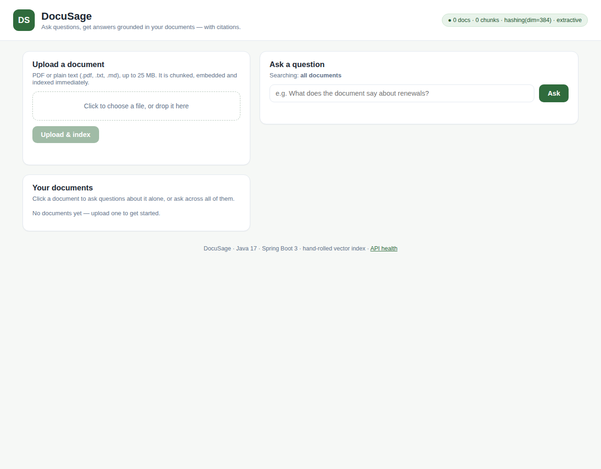
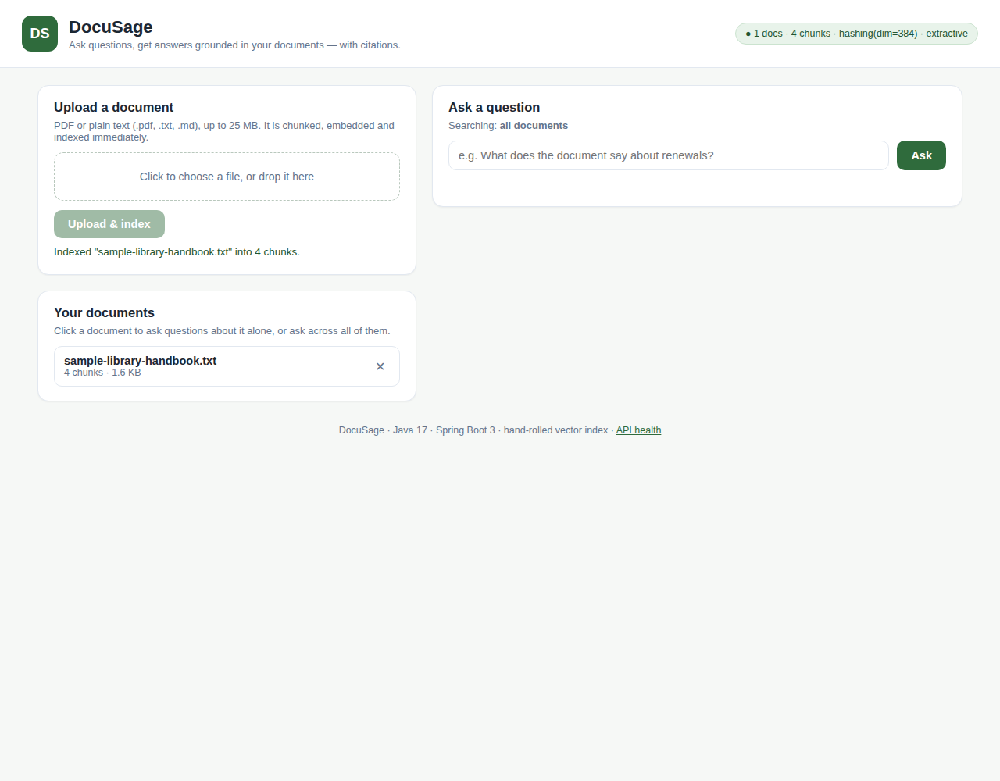
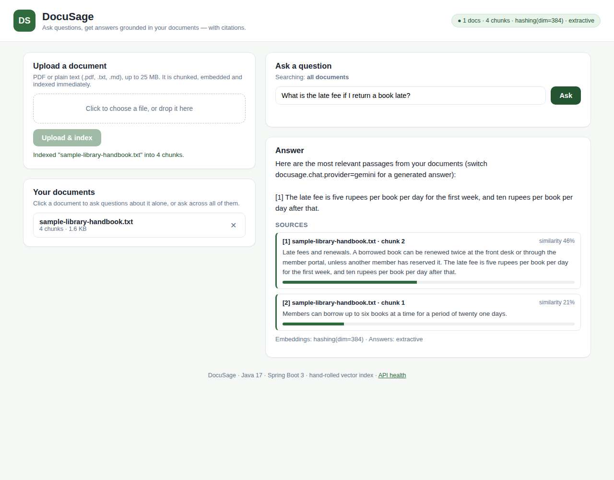

# DocuSage

**A Retrieval-Augmented Generation (RAG) backend in Java.** Upload PDF or text documents, ask questions in plain English, and get answers grounded in *your* documents — with the exact passages cited as evidence.

Built with **Java 17 · Spring Boot 3 · Spring Data JPA · Apache PDFBox · JUnit 5**, and a **hand-rolled vector index** (no vector database library) so the retrieval math is visible, testable, and explainable.

---

## Why this project exists

A raw LLM doesn't know anything about *your* documents, and it will happily invent answers. RAG fixes that: instead of asking the model from memory, you first **retrieve** the relevant passages from your own documents and let the model answer **only from those passages**, citing them.

DocuSage implements the complete RAG pipeline end to end — ingestion, chunking, embedding, vector search, grounded answering — behind a small REST API. It also runs **with zero configuration and no API key**: local providers handle embeddings and answers out of the box, and real AI providers (Google Gemini) plug in through configuration, not code changes.

---

## How RAG works here

### Ingestion (once per document)

```
 file ──► extract text ──► split into chunks ──► embed each chunk ──► store + index
 (PDF/TXT)   (PDFBox)       (900 chars,          (vector per chunk)   (JPA + in-memory
                              120 overlap)                             vector index)
```

1. **Extract** — PDFs are parsed with Apache PDFBox; `.txt`/`.md` files are read as UTF-8 text.
2. **Chunk** — text is split into ~900-character chunks with 120 characters of overlap, preferring sentence boundaries. Overlap exists so a sentence cut in half by a chunk boundary still appears whole in a neighbouring chunk.
3. **Embed** — each chunk is converted into a vector (a list of floats) that captures its content.
4. **Store + index** — chunk text and its vector are persisted (JPA/H2), and the vector is loaded into the in-memory `VectorIndex`. On restart, the index is rebuilt from the database automatically.

### Query (once per question)

```
 question ──► embed ──► cosine-similarity search ──► top-4 chunks ──► answer + citations
                          over the vector index        (the retrieval)   (grounded in them)
```

1. The question is embedded with the **same** provider used at ingestion.
2. The index computes **cosine similarity** between the question vector and every chunk vector and returns the top *k* (default 4).
3. The chat provider answers using **only** those chunks. With the Gemini provider, the prompt explicitly instructs the model to refuse ("The documents do not contain that information") when the context doesn't support an answer, and to cite passages as `[1]`, `[2]`, …
4. The API returns the answer **and** the citation list (document, chunk number, similarity score, excerpt) so every answer is auditable.

---

## Features

- 🖥️ **Web UI included** — a dependency-free single-page app served by the backend itself: upload documents, manage them, ask questions, and read answers with citation cards and similarity bars.
- 📄 **Document management API** — upload (PDF/TXT), list, inspect, delete; deleting a document removes its chunks from both the database and the index.
- 🔎 **Semantic-style retrieval** over a hand-built vector index with exact cosine-similarity search and optional per-document scoping.
- 🧩 **Pluggable providers** — embeddings and chat each sit behind an interface:
  - *Embeddings:* local **feature-hashing** provider (no key needed) or **Gemini** (`text-embedding-004`).
  - *Answers:* local **extractive** provider (returns the best passages verbatim — zero hallucination possible) or **Gemini** (`gemini-2.0-flash`) for fluent, cited answers.
- ♻️ **Restart-safe** — the in-memory index is rebuilt from persisted chunks on boot.
- ✅ **Validated, consistent errors** — Bean Validation on requests and a global exception handler returning a uniform JSON error shape.
- 🧪 **Tested core** — unit tests for the chunker, the vector index math, and the embedding provider, plus a Spring context test.

---

## Architecture

```
                        ┌──────────────────────── Spring Boot app ────────────────────────┐
                        │                                                                   │
  HTTP client ─────────►│  DocumentController        QaController         HealthController  │
                        │        │                        │                                   │
                        │        ▼                        ▼                                   │
                        │  DocumentService            QaService                             │
                        │   │        │                  │        │                            │
                        │   ▼        ▼                  ▼        ▼                            │
                        │ TextChunker  EmbeddingProvider ─┐   ChatProvider                  │
                        │              (hashing|gemini)    │    (extractive|gemini)         │
                        │                                 ▼                                 │
                        │                            VectorIndex  ◄── cosine top-k search   │
                        │                                 ▲                                 │
                        │              JPA repositories │ (rebuild on startup)              │
                        │                                 ▼                                 │
                        │                     H2 database (documents, chunks)             │
                        └───────────────────────────────────────────────────────────────────┘
```

| Layer | Classes | Responsibility |
|---|---|---|
| `controller/` | `DocumentController`, `QaController`, `HealthController` | HTTP surface only — no business logic |
| `service/` | `DocumentService`, `QaService`, `TextChunker`, `VectorIndex` | Ingestion pipeline, query pipeline, retrieval |
| `service/embedding/` | `EmbeddingProvider`, `HashingEmbeddingProvider`, `GeminiEmbeddingProvider` | Text → vector, strategy pattern |
| `service/chat/` | `ChatProvider`, `ExtractiveChatProvider`, `GeminiChatProvider` | Question + chunks → answer, strategy pattern |
| `model/` + `repository/` | `DocumentEntity`, `ChunkEntity`, JPA repositories | Persistence |
| `dto/` | `AskRequest`, `AskResponse`, `DocumentResponse` | API contracts (Java records) |
| `exception/` | `GlobalExceptionHandler`, `NotFoundException` | Uniform error responses |

---

## Tech stack

| | |
|---|---|
| Language | Java 17 |
| Framework | Spring Boot 3.2 (Web, Data JPA, Validation) |
| PDF parsing | Apache PDFBox 3 |
| Database | H2 (embedded, zero-setup) — swappable for PostgreSQL |
| Embeddings | Feature hashing (local) or Gemini `text-embedding-004` |
| Answers | Extractive (local) or Gemini `gemini-2.0-flash` |
| Build | Maven |
| Tests | JUnit 5, Spring Boot Test |

---

## Quickstart

**Prerequisites:** JDK 17+ and Maven 3.8+.

```bash
git clone https://github.com/sangameshh31/DocuSage.git
cd DocuSage
mvn spring-boot:run
```

The API is now on `http://localhost:8080` — no keys, no external services, nothing else to install. Open that address in a browser for the **web UI** (upload, ask, citations), or drive the API directly:

### Try it in 30 seconds

```bash
# 1. Check health (shows active providers and index size)
curl http://localhost:8080/api/health

# 2. Upload a document (any PDF, or a plain text file)
curl -F "file=@notes.txt" http://localhost:8080/api/documents

# 3. Ask a question about it
curl -X POST http://localhost:8080/api/ask \
  -H "Content-Type: application/json" \
  -d '{"question": "What is this document about?"}'
```

Example answer (default local providers):

```json
{
  "answer": "Here are the most relevant passages from your documents (switch docusage.chat.provider=gemini for a generated answer):\n\n[1] ...",
  "citations": [
    {
      "documentId": "3f6b…",
      "documentName": "notes.txt",
      "chunkIndex": 0,
      "score": 0.8123,
      "excerpt": "…"
    }
  ],
  "embeddingProvider": "hashing(dim=384)",
  "chatProvider": "extractive"
}
```

### Turn on real AI (optional)

With a [Google AI Studio](https://aistudio.google.com/apikey) API key, switch both providers to Gemini in `application.properties` (or via environment) for true semantic embeddings and generated, cited answers:

```bash
export GEMINI_API_KEY=your-key
# then set in application.properties:
#   docusage.embedding.provider=gemini
#   docusage.chat.provider=gemini
mvn spring-boot:run
```

> ⚠️ If you change the embedding provider, re-upload your documents — vectors from different providers live in different spaces and can't be mixed (the index detects dimension mismatches and fails loudly rather than returning nonsense).

---

## Deployment

DocuSage packages as a single executable jar and ships with a multi-stage `Dockerfile`, so it deploys anywhere that runs containers or Java 17.

**With Docker (one command):**

```bash
docker compose up --build
```

The compose file mounts a volume and switches H2 to a file database, so uploaded documents survive restarts. Without Docker:

```bash
mvn package -DskipTests
java -jar target/docusage-1.0.0.jar
```

**On a hosting platform** (Render, Railway, Fly.io, a VPS): point it at this repo — the Dockerfile is auto-detected, the app reads the platform's `PORT` environment variable, and `GEMINI_API_KEY` can be set as a platform secret if you enable the Gemini providers. For a production deployment beyond a demo, swap H2 for PostgreSQL (see the roadmap).

---

## Screenshots

The built-in web UI (served from `src/main/resources/static`, no frontend dependencies):

**Empty state** — upload panel, document list, and the live status pill (documents, chunks, active providers):



**After uploading a document** — it is chunked, embedded, and indexed immediately:



**Answer with citations** — the answer plus the exact passages it is grounded in, with similarity scores:



---

## API reference

| Method | Endpoint | Description |
|---|---|---|
| `GET` | `/api/health` | Status, document/chunk counts, active providers |
| `POST` | `/api/documents` | Upload a document (`multipart/form-data`, field `file`, max 25 MB). Extracts, chunks, embeds, indexes it |
| `GET` | `/api/documents` | List all documents |
| `GET` | `/api/documents/{id}` | One document's metadata |
| `DELETE` | `/api/documents/{id}` | Delete a document and all its chunks |
| `POST` | `/api/ask` | Ask a question. Body: `{"question": "…", "documentId": "optional — scope to one document"}` |

Errors use one shape everywhere:

```json
{ "timestamp": "…", "status": 404, "error": "Not Found", "message": "Document not found: …" }
```

---

## The hand-rolled vector index

`VectorIndex` is deliberately dependency-free, ~120 lines:

- **Storage** — a `ConcurrentHashMap<chunkId, IndexedChunk>`; each entry holds the chunk text and its float vector.
- **Search** — exact brute-force scan: cosine similarity against every vector, sorted, top-*k* returned. Because providers L2-normalize their vectors, cosine similarity reduces to a dot product.
- **Complexity** — O(n·d) per query (n chunks, d dimensions). Exact and correct; comfortable into the tens of thousands of chunks.
- **Why not an approximate index (HNSW/IVF)?** Approximate indexes trade a little accuracy for large speedups that only matter at millions of vectors. At this scale exact search is simpler *and* better. The roadmap below adds HNSW as a learning exercise, behind the same interface.
- **Persistence** — vectors are serialized as comma-separated floats into the `chunks` table and reloaded on startup, so the index survives restarts without re-embedding.

### Design trade-offs, stated honestly

| Decision | Why | Cost |
|---|---|---|
| Feature-hashing embeddings by default | Runs anywhere, no key, no model download; great for demos and tests | Captures *word overlap*, not true meaning ("car" ≠ "automobile"). Gemini provider fixes this |
| Extractive answers by default | Impossible to hallucinate; citations *are* the answer | Reads like search results, not prose. Gemini provider fixes this |
| H2 in-memory database | Zero setup for anyone cloning the repo | Data resets unless you point it at a file/Postgres (one config block) |
| Brute-force search | Exact results, trivially correct, easy to test | Won't scale to millions of chunks — see roadmap |

---

## Configuration

All settings live in `src/main/resources/application.properties` under `docusage.*`:

| Property | Default | Meaning |
|---|---|---|
| `docusage.chunk-size` | `900` | Characters per chunk |
| `docusage.chunk-overlap` | `120` | Overlap between consecutive chunks |
| `docusage.top-k` | `4` | Chunks retrieved per question |
| `docusage.embedding.provider` | `hashing` | `hashing` or `gemini` |
| `docusage.embedding.dimension` | `384` | Vector size for the hashing provider |
| `docusage.chat.provider` | `extractive` | `extractive` or `gemini` |
| `docusage.gemini.api-key` | `${GEMINI_API_KEY:}` | Gemini API key (env var) |
| `docusage.gemini.embedding-model` | `text-embedding-004` | Gemini embedding model |
| `docusage.gemini.chat-model` | `gemini-2.0-flash` | Gemini chat model |

---

## Tests

```bash
mvn test
```

- `TextChunkerTest` — splitting, overlap, boundary and argument-validation behaviour
- `VectorIndexTest` — cosine math (identical = 1, orthogonal = 0), ranking order, per-document scoping, deletion, serialization round-trip, dimension-mismatch guard
- `HashingEmbeddingProviderTest` — dimension, normalization, determinism, and that lexically-similar text scores closer than unrelated text
- `DocusageApplicationTests` — full Spring context boots

---

## Project structure

```
src/main/java/com/docusage/
├── DocusageApplication.java
├── config/AppProperties.java          # all docusage.* settings
├── controller/                        # REST endpoints
├── dto/                               # request/response records
├── exception/                         # uniform error handling
├── model/                             # JPA entities
├── repository/                        # Spring Data repositories
└── service/
    ├── DocumentService.java           # ingest pipeline + index rebuild
    ├── QaService.java                 # query pipeline
    ├── TextChunker.java               # overlapping chunk splitter
    ├── VectorIndex.java               # hand-rolled cosine top-k index
    ├── embedding/                     # EmbeddingProvider + 2 implementations
    └── chat/                          # ChatProvider + 2 implementations
```

---

## Roadmap

- [ ] HNSW approximate index behind the `VectorIndex` interface, benchmarked against exact search
- [ ] PostgreSQL + pgvector profile for persistent, native vector storage
- [ ] Streaming answers (SSE) from the Gemini provider
- [ ] OCR for scanned PDFs (Tesseract) and more formats (DOCX, HTML, Markdown)
- [ ] Re-ranking stage (cross-encoder) between retrieval and answering
- [ ] Docker Compose for one-command deployment

---

## What this project demonstrates

- Designing and implementing a **complete RAG pipeline** (chunking → embedding → retrieval → grounded generation) rather than calling a framework that hides it
- **Data structures in production clothing**: a vector index with exact cosine top-k search, serialization, and startup rebuild
- **Clean Spring Boot architecture**: layered controllers/services, strategy-pattern providers, configuration-driven behaviour, global exception handling, Bean Validation
- **Honest engineering**: defaults that run anywhere, explicit trade-offs, and tests around the parts with real logic

### One-line resume version

> Built **DocuSage**, a RAG document-Q&A backend in Java 17/Spring Boot 3: PDF ingestion and overlapping text chunking, a hand-rolled in-memory vector index with cosine top-k retrieval, pluggable embedding/chat providers (local feature-hashing and Gemini), and citation-grounded answers over a REST API, with JUnit tests for the retrieval core.

---

## License

MIT — free to use, learn from, and build on.
